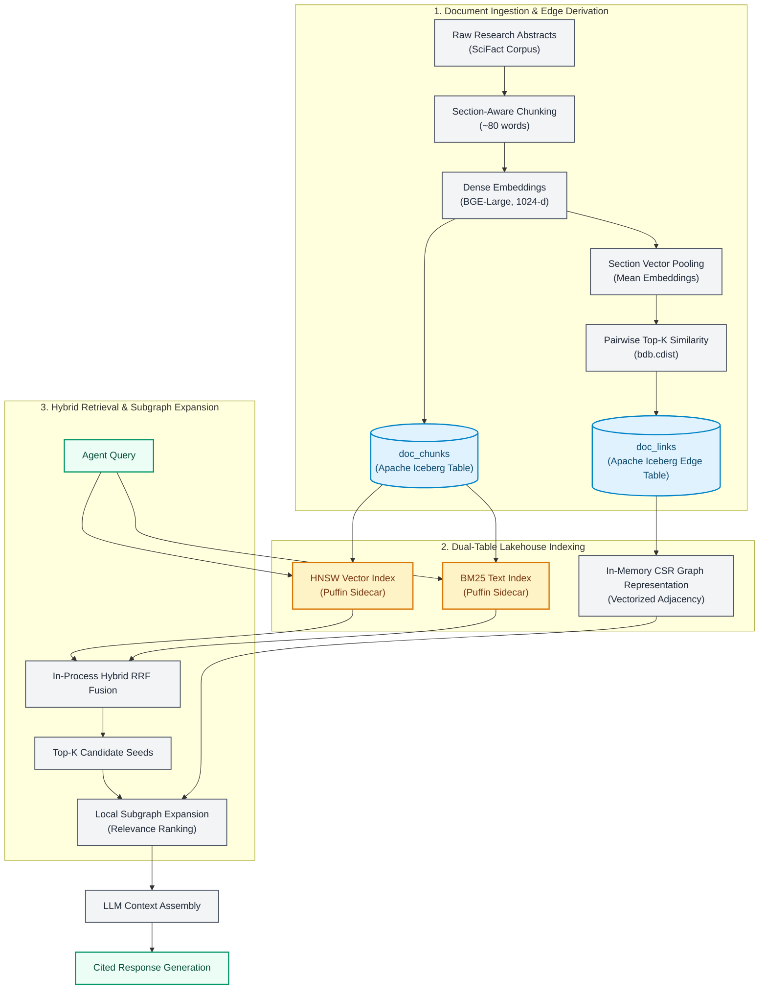

# RAG Meets Graph Analytics: Building Hybrid Retrieval on Iceberg with BenoDB

*By Rick Albright · Article 1 of the BenoDB Architecture Series · [Documentation](https://www.benolabsai.com/docs/) · [GitHub](https://github.com/benolabsai/benodb)*

---

Every time I look at a modern Graph Rag architecture diagram, I just shake my head in disgust.

To build a serious retrieval pipeline today, teams are routinely told they need to deploy, pay for, and synchronize three separate database clusters: a dedicated vector database for dense embeddings, an Elasticsearch or OpenSearch cluster for keyword search and exact acronyms, and a graph database for multihop relationship reasoning. This architecture triples infrastructure spend, introduces dual write synchronization drift, adds network latency to every query, and locks data into proprietary storage formats.

Why are we operating three database servers for a 50,000-document corpus?

The thesis for AI agents is straightforward: **don't choose between vectors, keywords, and graphs — unify all three.** Dense vectors capture fuzzy conceptual similarity, BM25 provides lexical ranking for exact terms and acronyms that dense models may underweight, and graph topology traces inferred semantic relationships across documents.

We built [BenoDB](https://www.benolabsai.com/docs/) to eliminate this sprawl. By embedding Apache DataFusion in Rust directly over open Apache Iceberg tables, BenoDB runs vector ANN search (HNSW), full-text retrieval (BM25), and graph traversal (CSR) in a single in process engine—with PostgreSQL-compatible pgvector distance operators (`<=>`), zero server daemons, and open Parquet lakehouse storage.

In this walkthrough, I take **5,183 research abstracts from the Allen Institute for AI's SciFact benchmark** and build an end-to-end Graph RAG pipeline from scratch: from section-aware chunking and in-process vector SQL to hardware-adaptive graph derivation and cited LLM answers.

> **Developer Preview Scope (>= v0.17.1):** Ready today for evaluation and experimentation: embedded in process execution (Python and Rust), pgvector-compatible distance operators (`<=>`, `<->`, `<#>`) embedded in DataFusion, advisory Puffin index sidecars, TurboQuant™ TQ8 quantization, and GPU-accelerated batch distance kernels (`bdb.cdist`). What is intentionally out of scope for this release: distributed multinode consensus, distributed sharding, and multistatement transactions across tables.
>
> **One Canonical Data Store:** Primary records and embeddings reside in standard Parquet files governed by Iceberg. Secondary indexes accelerate retrieval without requiring separate primary-data stores.
>
> **Interactive Notebook:** [Download .ipynb](https://raw.githubusercontent.com/benolabsai/benodb/main/notebooks/graph_rag_howto.ipynb) · [View on GitHub](https://github.com/benolabsai/benodb/blob/main/notebooks/graph_rag_howto.ipynb)

## Step 1: Ingesting 5,183 Paper Abstracts (And Why Naive Chunking Destroys RAG)

Before touching a single line of database code, let's confront the dirty secret of retrieval-augmented generation: **bad chunking will ruin even the best embedding model**.

If you blindly slice documents every 500 tokens with a fixed sliding window, you will inevitably split a hypothesis in `BACKGROUND` from its refutation in `RESULTS`. When the LLM cites the hypothesis as the finding, your agent hallucinates.

To keep this real, we aren't using toy synthetic text. We’re loading 5,183 research abstracts from the Allen Institute for AI's SciFact benchmark. Of these, 977 contain explicit section labels such as BACKGROUND, METHODS, RESULTS, and CONCLUSIONS. The accompanying claims dataset provides expert-annotated evidence citations for retrieval evaluation.

Let's download the corpus and inspect the structure:


```python
import json
import os
import tarfile
import tempfile
import urllib.request
from pathlib import Path

# Portable working directory. Override with BENOLABS_WORKDIR if desired.
# Defaults to ./benolabs_howto; if that location is not writable (e.g. a
# downloaded notebook opened from a read-only folder), fall back to the OS
# temp directory, which exists on Linux, macOS, and Windows.
def _default_workdir() -> Path:
    env = os.environ.get("BENOLABS_WORKDIR")
    if env:
        return Path(env).expanduser()
    if (Path.cwd() / "data" / "corpus.jsonl").exists():
        return Path.cwd()
    if (Path.cwd() / "notebooks" / "data" / "corpus.jsonl").exists():
        return Path.cwd() / "notebooks"
    candidate = Path.cwd() / "benolabs_howto"
    try:
        candidate.mkdir(parents=True, exist_ok=True)
        probe = candidate / ".write-test"
        probe.write_text("", encoding="utf-8")
        probe.unlink()
        return candidate
    except OSError:
        return Path(tempfile.gettempdir()) / "benolabs_howto"


WORK_DIR = _default_workdir()
WORK_DIR.mkdir(parents=True, exist_ok=True)
DATA_DIR = WORK_DIR / "data"
CORPUS_PATH = DATA_DIR / "corpus.jsonl"
ARCHIVE_PATH = DATA_DIR / "scifact_data.tar.gz"
URL = "https://scifact.s3.us-west-2.amazonaws.com/release/latest/data.tar.gz"

# Auto-download and extract SciFact corpus on first run
if not CORPUS_PATH.exists():
    DATA_DIR.mkdir(parents=True, exist_ok=True)
    if not ARCHIVE_PATH.exists():
        print(f"Downloading SciFact corpus from {URL}...")
        urllib.request.urlretrieve(URL, ARCHIVE_PATH)
    print("Extracting dataset archive safely...")
    target_dir = DATA_DIR.resolve()
    with tarfile.open(ARCHIVE_PATH, "r:gz") as tar:
        for member in tar.getmembers():
            if member.name.startswith("data/"):
                rel_name = member.name[len("data/"):]
                if not rel_name:
                    continue
                dest_path = (target_dir / rel_name).resolve()
                if not dest_path.is_relative_to(target_dir):
                    raise ValueError(f"Path traversal detected in archive: {member.name}")
                member.name = rel_name
                if hasattr(tarfile, "data_filter"):
                    tar.extract(member, path=DATA_DIR, filter="data")
                else:
                    tar.extract(member, path=DATA_DIR)
    print(f"Corpus ready at {CORPUS_PATH}")

docs = []
with CORPUS_PATH.open() as f:
    for line in f:
        r = json.loads(line)
        docs.append({
            "doc_id": int(r["doc_id"]),
            "title": r["title"],
            "sentences": r["abstract"],          # keep sentence boundaries
            "structured": bool(r.get("structured", False)),
        })

title_by_id = {d["doc_id"]: d["title"] for d in docs}

print(f"Loaded {len(docs):,} documents")
print(f"Structured (labelled sections): {sum(d['structured'] for d in docs):,}")
d = docs[0]
print(f"\nExample doc_id={d['doc_id']}")
print(f"  title: {d['title'][:80]}")
print(f"  first sentence: {d['sentences'][0][:100]}...")
```

    Loaded 5,183 documents
    Structured (labelled sections): 977
    
    Example doc_id=4983
      title: Microstructural development of human newborn cerebral white matter assessed in v
      first sentence: Alterations of the architecture of cerebral white matter in the developing human brain can affect co...


### Intelligent Chunking: Respecting Section Boundaries

Of these abstracts, 977 contain explicit uppercase section headers. Conventional RAG pipelines rely on fixed 500-token windows with 50-token overlap. In scientific literature, **blind windowing violates structural boundaries:** a chunk spanning METHODS and RESULTS conflates experimental protocol with observed findings, degrading downstream retrieval precision.

Here, we partition text **strictly within labelled section boundaries**, accumulating sentences into coherent passages up to approximately 80 words (individual sentences that exceed 80 words are preserved intact). If a section ends, the chunk ends. No bleeding, no blurred context:


```python
import re
from collections import defaultdict

SECTION_RE = re.compile(
    r"^(BACKGROUND|OBJECTIVE|OBJECTIVES|PURPOSE|INTRODUCTION|IMPORTANCE|"
    r"METHODS?|DESIGN|SETTING|PARTICIPANTS|INTERVENTION|MEASUREMENTS|"
    r"RESULTS?|FINDINGS|DISCUSSION|CONCLUSIONS?|SIGNIFICANCE)\b"
)


def labelled(sentences):
    """Yield (section, sentence). Detects all-caps section headers."""
    section = "ABSTRACT"
    for s in sentences:
        m = SECTION_RE.match(s)
        if m:
            section = m.group(1)
            s = s[m.end():].strip()
        if s:
            yield section, s


def chunk_doc(doc, max_words=80):
    """List of (section, text), never crossing a section boundary."""
    out, buf, n, cur = [], [], 0, None
    for section, s in labelled(doc["sentences"]):
        if cur is not None and section != cur and buf:
            out.append((cur, " ".join(buf))); buf, n = [], 0
        cur = section
        w = len(s.split())
        if buf and n + w > max_words:
            out.append((cur, " ".join(buf))); buf, n = [], 0
        buf.append(s); n += w
    if buf:
        out.append((cur, " ".join(buf)))
    return out


rows = []
for d in docs:
    for section, text in chunk_doc(d):
        rows.append({
            "doc_id": d["doc_id"],
            "section": section,
            "section_id": f"{d['doc_id']}:{section}",
            "text": text,
        })

# The graph engine uses UInt64 node ids, so assign each section a dense node index.
section_ids = sorted({r["section_id"] for r in rows})
node_of = {sid: i for i, sid in enumerate(section_ids)}
label_of = {i: sid for sid, i in node_of.items()}
for r in rows:
    r["section_node"] = node_of[r["section_id"]]

counter = defaultdict(int)
for r in rows:
    r["chunk_idx"] = counter[r["doc_id"]]
    counter[r["doc_id"]] += 1

print(f"{len(rows):,} chunks from {len(docs):,} docs")
print(f"sections: {sorted({r['section'] for r in rows})[:8]}... ({len(set(r['section'] for r in rows))} total)")
print(f"section nodes: {len(section_ids):,}")
```

    18,404 chunks from 5,183 docs
    sections: ['ABSTRACT', 'BACKGROUND', 'CONCLUSION', 'CONCLUSIONS', 'DESIGN', 'DISCUSSION', 'FINDINGS', 'IMPORTANCE']... (21 total)
    section nodes: 8,075


### Generating Dense Embeddings

From 5,183 research abstracts, we now have **18,404 clean, self-contained chunks** across 8,075 section nodes. Every passage knows its parent document, its section type, and its sequence position.

Now we encode each passage into a 1024-dimensional dense vector using `BAAI/bge-large-en-v1.5`, a production-grade embedding model. We L2-normalize the vectors upfront so that computing cosine similarity reduces to a fast dot product:


```python
import os, json, hashlib, warnings
from pathlib import Path
import numpy as np

warnings.filterwarnings("ignore")

MODEL_NAME = "BAAI/bge-large-en-v1.5"
DIM = 1024
QUERY_PREFIX = "Represent this sentence for searching relevant passages: "

model = None
DEVICE = "cpu"


def get_embedding_model():
    """Lazily load SentenceTransformer on demand with device fallback."""
    global model, DEVICE
    if model is None:
        import torch
        from sentence_transformers import SentenceTransformer

        device_env = os.environ.get("BENOLABS_EMBED_DEVICE")
        if device_env:
            DEVICE = device_env
        elif torch.cuda.is_available():
            try:
                torch.cuda.empty_cache()
                _probe = torch.zeros(1, device="cuda:0")
                DEVICE = "cuda:0"
            except Exception:
                DEVICE = "cpu"
        elif torch.backends.mps.is_available():
            DEVICE = "mps"
        else:
            DEVICE = "cpu"

        try:
            model = SentenceTransformer(MODEL_NAME, device=DEVICE, local_files_only=True)
        except Exception:
            try:
                model = SentenceTransformer(MODEL_NAME, device=DEVICE)
            except Exception as e:
                print(f"Warning: Failed loading {MODEL_NAME} on {DEVICE} ({e}). Falling back to CPU.")
                DEVICE = "cpu"
                model = SentenceTransformer(MODEL_NAME, device=DEVICE)
    return model


def embed_docs(texts):
    m = get_embedding_model()
    return m.encode(texts, normalize_embeddings=True, show_progress_bar=True, batch_size=256)


def embed_query(text):
    m = get_embedding_model()
    return m.encode([QUERY_PREFIX + text],
                    normalize_embeddings=True, show_progress_bar=False)[0]


# Validate precomputed embedding cache before initializing embedding model
VEC_CACHE = DATA_DIR / "vectors_bge_large.npy"
META_CACHE = DATA_DIR / "vectors_bge_large.meta.json"

# Compute deterministic provenance fingerprint over corpus chunk structure
corpus_hasher = hashlib.sha256()
for r in rows:
    corpus_hasher.update(str(r["doc_id"]).encode("utf-8"))
    corpus_hasher.update(str(r["section"]).encode("utf-8"))
    corpus_hasher.update(str(len(r["text"])).encode("utf-8"))
corpus_fingerprint = corpus_hasher.hexdigest()[:16]

cache_valid = False
if VEC_CACHE.exists():
    try:
        # Inspect array header via memory-map without loading unneeded bytes
        mmap_vectors = np.load(VEC_CACHE, mmap_mode="r")
        if mmap_vectors.shape != (len(rows), DIM):
            print(f"Cache shape mismatch: {mmap_vectors.shape} vs expected ({len(rows)}, {DIM})")
        elif META_CACHE.exists():
            with open(META_CACHE, "r") as f:
                meta = json.load(f)
            if meta.get("model") != MODEL_NAME or meta.get("fingerprint") != corpus_fingerprint:
                print(f"Cache provenance mismatch: expected model={MODEL_NAME}, fp={corpus_fingerprint}; found {meta}")
            else:
                cache_valid = True
                vectors = np.array(mmap_vectors)
        else:
            # Bootstrap provenance metadata for existing valid cache
            cache_valid = True
            vectors = np.array(mmap_vectors)
            with open(META_CACHE, "w") as f:
                json.dump({"model": MODEL_NAME, "dim": DIM, "rows": len(rows), "fingerprint": corpus_fingerprint}, f, indent=2)
    except Exception as e:
        print(f"Cache validation error: {e}")

if cache_valid:
    rel_cache = VEC_CACHE.relative_to(WORK_DIR) if VEC_CACHE.is_relative_to(WORK_DIR) else VEC_CACHE.name
    print(f"Loaded validated precomputed embeddings from {rel_cache} (shape={vectors.shape}, model={MODEL_NAME}, fingerprint={corpus_fingerprint})")
else:
    print(f"Cache miss: Initializing {MODEL_NAME} to generate embeddings for {len(rows):,} chunks...")
    vectors = embed_docs([r["text"] for r in rows])
    VEC_CACHE.parent.mkdir(parents=True, exist_ok=True)
    np.save(VEC_CACHE, vectors)
    with open(META_CACHE, "w") as f:
        json.dump({"model": MODEL_NAME, "dim": DIM, "rows": len(rows), "fingerprint": corpus_fingerprint}, f, indent=2)
    print(f"Saved embedding cache and provenance metadata to {VEC_CACHE.name}")

print(f"Embeddings ready: shape={vectors.shape}  dim={DIM}")
```

    Loaded validated precomputed embeddings from data/vectors_bge_large.npy (shape=(18404, 1024), model=BAAI/bge-large-en-v1.5, fingerprint=d96e02ef3a803834)
    Embeddings ready: shape=(18404, 1024)  dim=1024


## Step 2: Creating the Lakehouse Table (Parquet + Advisory Sidecars)

At this point, typical RAG architectures introduce unnecessary distributed overhead.

Conventionally, you would push vectors to Pinecone, serialize text into Elasticsearch, reconcile disparate identifiers across both engines, and operate a CDC pipeline to mitigate synchronization lag.

In BenoDB, we do something radically simpler: **we write one table directly to open Apache Iceberg storage**.

We define a standard PyArrow schema, declare our **HNSW vector index** on `embedding`, declare our **BM25 index** on `text`, and commit the data in a single batch:


```python
import shutil
import pyarrow as pa
import benodb as bdb

TABLE_DIR = WORK_DIR / "scifact"
TABLE_URI = TABLE_DIR.resolve().as_uri()
shutil.rmtree(TABLE_DIR, ignore_errors=True)

schema = pa.schema([
    ("doc_id", pa.int64()),
    ("section", pa.string()),
    ("section_id", pa.string()),
    ("section_node", pa.uint64()),
    ("chunk_idx", pa.int32()),
    ("text", pa.large_string()),
    ("embedding", pa.list_(pa.float32(), DIM)),
])

doc_chunks = bdb.Table.create(TABLE_URI, schema)

# Configure vector (HNSW) and full-text (BM25) indexes on the table
doc_chunks.add_index("embedding", "hnsw")
doc_chunks.add_index("text", "bm25")

# Declare the embedding contract in Iceberg table properties
doc_chunks.set_properties({
    "benostream.embedding.model": MODEL_NAME,
    "benostream.embedding.dim": str(DIM),
})

doc_chunks.write_arrow(pa.table({
    "doc_id": pa.array([r["doc_id"] for r in rows], pa.int64()),
    "section": pa.array([r["section"] for r in rows], pa.string()),
    "section_id": pa.array([r["section_id"] for r in rows], pa.string()),
    "section_node": pa.array([r["section_node"] for r in rows], pa.uint64()),
    "chunk_idx": pa.array([r["chunk_idx"] for r in rows], pa.int32()),
    "text": pa.array([r["text"] for r in rows], pa.large_string()),
    "embedding": pa.FixedSizeListArray.from_arrays(
        pa.array(vectors.reshape(-1), pa.float32()), DIM),
}))
doc_chunks.commit()
doc_chunks.wait_for_background_tasks()

print(f"Committed {doc_chunks.row_count:,} rows to {TABLE_URI}")
print("Indexes ready: hnsw(embedding) + bm25(text)")
```

    Committed 18,404 rows to file:///home/ralbright/projects/benodb/notebooks/benolabs_howto/scifact
    Indexes ready: hnsw(embedding) + bm25(text)


### Under the Hood: Why Lakehouse Storage & Sidecars Matter

In the ingestion above, BenoDB runs entirely in process, with no external database server running in the background, no Postgres daemon, and no JVM runtime.

Under the hood, BenoDB wrote standard Apache Parquet data files tracked by an open Apache Iceberg manifest. Two architectural mechanisms make this layout both performant and operationally manageable:

1. **No Separate Canonical Data Store & Open Standards:** Primary data (text, identifiers, metadata, and Float32 embeddings) resides in standard Parquet files. Because Iceberg is an open table format, data is never locked in a proprietary database silo; the exact same tables remain directly queryable by DuckDB, Trino, or Apache Spark.
2. **Advisory Puffin Sidecars vs. Edge Tables:**
   - **HNSW and BM25 Sidecars:** Secondary retrieval indexes (HNSW graphs for vectors and BM25 inverted lists for text) are stored alongside Parquet files as advisory sidecars in standard Apache Iceberg Puffin format bound to table snapshots. If an index is rebuilt or dropped, canonical table rows remain untouched.
   - **Graph Topology Storage:** In this walkthrough, relationship edges are persisted as an independent Apache Iceberg edge table (`scifact_links`) in standard Parquet format. When graph operations run, the embedded engine loads the edge table into an in-memory Compressed Sparse Row (CSR) matrix for vectorized traversal and community detection. 

**Production Scale & Quantization:** In this walkthrough, we built an uncompressed Float32 HNSW index (`hnsw`). For multi-million-row datasets where memory is constrained, BenoDB supports pluggable 8-bit quantization (`hnsw_tq8` with randomized Walsh-Hadamard rotation on power-of-two dimensions, achieving >98% Recall@10 on the NeurIPS BigANN benchmark, and `sq8` for uniform scalar quantization), combined with second-pass Float32 reranking read directly from 32 KB Parquet data pages.

> 📖 **Dive Deeper:** For complete storage layout specifications, Iceberg table properties, and memory budgeting rules, see the [Lakehouse Architecture Guide](https://www.benolabsai.com/docs/guides/architecture.html) and [Resource Limits & Memory Discipline](https://www.benolabsai.com/docs/guides/resource_limits.html).

## Step 3: In Process SQL with Native pgvector Syntax

Now that our data and indexes are committed to the lakehouse, how do we query them?

Instead of inventing a bespoke query language or requiring developers to spin up a Postgres server just to get vector operators, BenoDB embeds Apache DataFusion in Rust. This exposes embedded DataFusion SQL with **pgvector-compatible distance operators** (`<=>` cosine distance, `<->` Euclidean L2 distance, `<#>` negative inner product) directly over Parquet tables in process:


```python
session = bdb.Session()
session.register("doc_chunks", doc_chunks)

# Inspect table health via in-process DataFusion SQL
df_cnt = session.sql("SELECT count(*) AS chunks FROM doc_chunks").to_pandas()
print(f"Registered 'doc_chunks' with {df_cnt.iloc[0]['chunks']:,} rows in Apache DataFusion session.")

```

    Registered 'doc_chunks' with 18,404 rows in Apache DataFusion session.


### Querying Vectors: Table API vs. In-Process pgvector SQL

To establish our baseline, let's query the table for a test claim:
$$\text{"smoking increases the risk of lung cancer"}$$

We can execute pure vector similarity search in two ways: via the high-level Python Table API (`doc_chunks.vector_search`), or via **pgvector-compatible distance operators in embedded SQL** using the `<=>` cosine distance operator inside Apache DataFusion.

Supported pgvector operators include:
- `<=>` : Cosine distance ($1 - \text{cosine similarity}$)
- `<->` : Euclidean L2 distance
- `<#>` : Negative inner product

Let's run both and inspect what pure vector search returns:


```python
query = "smoking increases the risk of lung cancer"
qvec = embed_query(query).tolist()

# A. Vector ANN Search via Python Table API
v_hits = doc_chunks.vector_search("embedding", qvec, k=3, metric="cosine")
print(f"Query: {query!r}\n")
print("--- Standalone Vector Search Hits (HNSW Index) ---")
for _, r in v_hits.iterrows():
    doc = int(r["doc_id"])
    print(f"  [{doc}] ({r['section']} #{r['chunk_idx']}, dist: {r['distance']:.4f}) {title_by_id.get(doc, '')[:65]}")

# B. pgvector-Compatible Distance Query in DataFusion SQL (<=> Operator)
sql_hits = session.sql(f"""
    SELECT doc_id, section, chunk_idx, text,
           embedding <=> {qvec} AS cosine_dist
    FROM doc_chunks
    ORDER BY cosine_dist ASC
    LIMIT 3
""").to_pandas()
print("\n--- In-Process pgvector SQL Query in DataFusion (<=> Operator) ---")
for _, r in sql_hits.iterrows():
    doc = int(r["doc_id"])
    print(f"  [{doc}] ({r['section']} #{r['chunk_idx']}, dist: {r['cosine_dist']:.4f}) {title_by_id.get(doc, '')[:65]}")

```

    Query: 'smoking increases the risk of lung cancer'
    
    --- Standalone Vector Search Hits (HNSW Index) ---
      [7639744] (RESULTS #5, dist: 0.5819) Prognosis of patients with non-small cell or small cell lung can
      [26067999] (ABSTRACT #4, dist: 0.5847) Screening for Lung Cancer: Systematic Review to Update the U.S. 
      [16422880] (OBJECTIVE #1, dist: 0.6094) Effect of smoking reduction on lung cancer risk.
    
    --- In-Process pgvector SQL Query in DataFusion (<=> Operator) ---
      [7639744] (RESULTS #5, dist: 0.1693) Prognosis of patients with non-small cell or small cell lung can
      [26067999] (ABSTRACT #4, dist: 0.1709) Screening for Lung Cancer: Systematic Review to Update the U.S. 
      [16422880] (OBJECTIVE #1, dist: 0.1857) Effect of smoking reduction on lung cancer risk.


### Distance Representations: Table API vs. Embedded SQL

If you look closely at the outputs above, both methods retrieved the **exact same three documents in the exact same rank order**, but their distance metrics report different numerical values:

1. **Table API (`doc_chunks.vector_search(..., metric="cosine")`):** When the HNSW index was created in Step 2 via `doc_chunks.add_index("embedding", "hnsw")`, the engine constructed an HNSW graph using its default build metric (`IndexAlgorithm::Hnsw { metric: "l2", ... }`). At query time, `vector_search` resolves through the accelerated index path (`search_hnsw_ivf`), which traverses the graph using the index internal distance metric ($L_2$). Because all embeddings were normalized ($\|u\|_2 = 1$) during Step 1, Euclidean distance is monotonically equivalent to cosine distance ($d_{L_2} = \sqrt{2 \cdot d_{\text{cosine}}}$), preserving identical nearest neighbor ordering. The index search returns its internal graph distance representation: chordal Euclidean $L_2$ distance ($0.5819$).
2. **In Process SQL (`<=>` operator):** Computes exact pgvector-compatible **cosine distance** inside DataFusion:
   $$d_{\text{cosine}} = 1 - \cos \theta = 1 - \frac{\langle u, v \rangle}{\|u\|_2 \|v\|_2} = \mathbf{0.1693}$$

The two values are related by the standard unit-sphere conversion:
$$d_{L_2} = \sqrt{2(1 - \cos \theta)} = \sqrt{2 \times 0.1693} = \mathbf{0.5819}$$

Both representations produce identical topological candidate rankings. The Table API executes accelerated HNSW graph traversal over advisory Puffin sidecars, while SQL provides PostgreSQL-compatible distance operators (`<=>`, `<->`, `<#>`) for analytical joins, filtering, and ad hoc expressions directly within DataFusion queries.

> 📖 **Dive Deeper:** For the complete catalog of supported pgvector operators, analytical joins on embeddings, and DataFusion execution details, explore the [pgvector SQL Guide](https://www.benolabsai.com/docs/guides/pgvector_sql_guide.html).

## Step 4: Hybrid Search in Action: Fusing Vectors and BM25

Pure vector search found semantically relevant passages, but anyone who has shipped RAG to production knows its Achilles' heel: **vector models frequently flub exact acronyms, chemical formulas, and product codes**. Conversely, BM25 provides lexical ranking for exact terms, acronyms, and product codes, providing a complementary signal to dense semantic vectors.

Operating separate vector and keyword search clusters introduces unnecessary coordination:
1. Sending an ANN request to Pinecone or Qdrant,
2. Sending a text query to Elasticsearch or OpenSearch,
3. Waiting for both remote responses over the network, and
4. Computing rank fusion in your application code.

`doc_chunks.hybrid_search()` eliminates that multi-service coordination. It evaluates dense vector ANN and BM25 index paths concurrently over advisory Puffin sidecars and fuses candidate ranks in-engine using **Reciprocal Rank Fusion (RRF)**:

$$\text{RRF}(d) = \sum_{m \in \{\text{dense}, \text{bm25}\}} \frac{1}{k + \text{rank}_m(d)}$$

Where $k=60$ is the standard smoothing constant, and $\text{rank}_m(d) \in \{1, 2, \dots\}$ is the 1-based rank of item $d$ within modality $m$.

With two retrieval modalities, the theoretical maximum possible score under this formula occurs when a candidate places rank #1 in both the dense vector and BM25 candidate lists:

$$\text{RRF}_{\max} = \frac{1}{60 + 1} + \frac{1}{60 + 1} = \frac{2}{61} \approx \mathbf{0.03279}$$

Whether your data lives on local disk or in cloud object storage (such as an S3 or MinIO bucket accessed from a developer laptop), the engine evaluates vector distances and BM25 postings directly against the Iceberg index sidecars, fusing scores in-engine before returning top candidates to your Python runtime.

Let's run the exact same query through hybrid search and watch what changes:


```python
TOP_K = 5

hits = doc_chunks.hybrid_search(
    text_column="text",
    query_text=query,
    vector_column="embedding",
    query_vector=qvec,
    k=TOP_K,
)
print(f"Query: {query!r}\n")
print("--- Top Hybrid Search Hits (Dense Vector + BM25 RRF) ---")
print(hits[["doc_id", "section", "chunk_idx", "rrf_score"]].to_string(index=False))
print("\nTop Hit Titles:")
for _, r in hits.head(3).iterrows():
    doc = int(r["doc_id"])
    print(f"  [{doc}] {title_by_id.get(doc, '')[:78]}")
```

    Query: 'smoking increases the risk of lung cancer'
    
    --- Top Hybrid Search Hits (Dense Vector + BM25 RRF) ---
      doc_id     section  chunk_idx  rrf_score
    26067999    ABSTRACT          4   0.032266
    26067999    ABSTRACT         17   0.032258
     7639744 CONCLUSIONS          7   0.030118
    12145359     RESULTS          2   0.030090
    16422880   OBJECTIVE          1   0.029851
    
    Top Hit Titles:
      [26067999] Screening for Lung Cancer: U.S. Preventive Services Task Force Recommendation 
      [7639744] Influence of smoking cessation after diagnosis of early stage lung cancer on p
      [12145359] Cigarette smoking and risk of histologic subtypes of epithelial ovarian cancer


Notice what happened when BM25 keyword matching and dense vector scores were fused:

1. **Direct Evidence Promoted to #1:** In pure vector search, the top result was document `7639744` (focused on smoking *cessation after diagnosis*—conceptually related, but an indirect match). Under hybrid search, BM25 matched the exact query tokens (*"smoking"*, *"risk"*, *"lung cancer"*), propelling document `26067999 Chunk #4` directly to rank #1 (`rrf_score: 0.032266`, fusing rank #3 in dense vector retrieval and rank #1 in BM25 lexical ranking). That chunk contains the definitive evidentiary sentence: *"The most important risk factor for lung cancer is smoking, which results in approximately 85% of all U.S. lung cancer cases."*
2. **Direct Epidemiological Studies Rescued:** Hybrid search elevated document `16422880` (*"Effect of smoking reduction on lung cancer risk"*) into the top candidates (`rrf_score: 0.029851`), capturing direct study data on lung cancer incidence that dense vector similarity had ranked lower down the candidate list.

### Scoped Search: SQL Predicate Pushdown

When an agent needs evidence for a claim, searching `METHODS` or `BACKGROUND` is often unhelpful. You want results strictly from `RESULTS` or `CONCLUSIONS`. BenoDB pushes SQL `filter` expressions directly into the storage engine before scoring, pruning index evaluation:


```python
scoped = doc_chunks.hybrid_search(
    text_column="text",
    query_text=query,
    vector_column="embedding",
    query_vector=qvec,
    k=TOP_K,
    filter="section IN ('RESULTS', 'RESULT', 'FINDINGS', 'CONCLUSIONS', 'CONCLUSION')",
)
print("Filtered strictly to Results & Conclusions:\n")
print(scoped[["doc_id", "section", "chunk_idx", "rrf_score"]].to_string(index=False))

```

    Filtered strictly to Results & Conclusions:
    
      doc_id     section  chunk_idx  rrf_score
     7639744 CONCLUSIONS          7   0.032002
    12145359     RESULTS          2   0.032002
     7639744     RESULTS          4   0.031545
     7639744     RESULTS          5   0.031010
     4828631    FINDINGS          4   0.030118


### Context Window Expansion: Adjacent Chunks in SQL

When an agent retrieves an isolated snippet, it often needs the surrounding narrative to synthesize an accurate answer. Because our table preserves `chunk_idx` sequentially across the abstract, pulling adjacent chunks ($c-1, c, c+1$) in a single in process SQL query provides surrounding context.

Because `chunk_idx` is assigned sequentially across the entire document rather than independently within each section, an unconstrained query could inadvertently cross from `RESULTS` into `METHODS` or `BACKGROUND`. Scoping the query with `AND section = '{top_section}'` guarantees that adjacent chunk retrieval strictly respects section boundaries:


```python
top = hits.iloc[0]
top_doc, top_ci, top_section = int(top["doc_id"]), int(top["chunk_idx"]), str(top["section"])

win = session.sql(f'''
    SELECT section, chunk_idx, text
    FROM doc_chunks
    WHERE doc_id = {top_doc}
      AND section = '{top_section}'
      AND chunk_idx BETWEEN {top_ci - 1} AND {top_ci + 1}
    ORDER BY chunk_idx
''').to_pandas()

print(f"Context Window around doc_id={top_doc} [{top_section} #{top_ci}]:\n")
for _, r in win.iterrows():
    print(f"[{r['section']} #{r['chunk_idx']}] {r['text'][:120]}...")
```

    Context Window around doc_id=7639744 [RESULTS #5]:
    
    [RESULTS #4] Continued smoking was associated with a significantly increased risk of all cause mortality (hazard ratio 2.94, 95% c...
    [RESULTS #5] No study contained data on the effect of quitting smoking on cancer specific mortality or on development of a secon...
    [RESULTS #6] In limited stage small cell lung cancer, an estimated 29% of continuing smokers would survive for five years compared...


> 📖 **Dive Deeper:** For the complete Python API reference covering hybrid scoring parameters, predicate pushdown filters, and candidate re-ranking, see the [Python Vector API Documentation](https://www.benolabsai.com/docs/guides/python_vector_api.html).


## Step 5: 50-Claim SciFact Retrieval Experiment (Illustrative Evaluation)

Now for the empirical test. Anyone can cherry-pick a single query that looks good in a demo. But how does hybrid retrieval actually perform when evaluated systematically against ground truth?

To find out, we evaluate an illustrative **50-claim evaluation subset** from the Allen Institute for AI's [SciFact](https://github.com/allenai/scifact) benchmark (`claims_dev.jsonl`). Each claim has expert-annotated ground-truth evidence citations (`cited_doc_ids`). Note that expert evidence annotations belong to the claims evaluation set; they are not annotations attached to every corpus abstract.

We evaluate the first 50 eligible claims with ground-truth evidence citations (`eval_subset = eval_claims[:50]`) across three retrieval strategies targeting $K=10$ unique documents:
1. **BM25 Only:** Lexical ranking over the inverted index.
2. **Vector Only:** Cosine similarity over normalized `bge-large-en-v1.5` dense embeddings.
3. **Hybrid Search:** Reciprocal Rank Fusion ($k=60$) combining vector distance and BM25 postings.

We compute macro-averaged mean per-query metrics: **document-level Recall@10** (fraction of ground-truth cited documents retrieved) and **document-level nDCG@10** (Normalized Discounted Cumulative Gain, weighting document hits by rank position). This evaluates evidence-source recovery (retrieving the cited papers) rather than passage-level span extraction or claim entailment.

> **Methodological Note on Chunk Deduplication & Candidate Depth:**
> Because the underlying index evaluates passage chunks while the SciFact benchmark evaluates document citations (`doc_id`), the evaluation retrieves a candidate pool of 50 chunks (`CANDIDATE_POOL = 50`) and deduplicates returned chunks by `doc_id` to assemble the top-10 unique documents per query. If a document contributes multiple chunks, deduplication ensures only the highest-ranked chunk determines the document's rank position.


```python
import random

CLAIMS_PATH = DATA_DIR / "claims_dev.jsonl"
eval_claims = []
with CLAIMS_PATH.open() as f:
    for line in f:
        c = json.loads(line)
        if c.get("cited_doc_ids"):
            eval_claims.append(c)

# First 50 eligible claims with ground-truth evidence citations
eval_subset = eval_claims[:50]

eval_results = {
    "BM25 Only": {"recall": [], "ndcg": []},
    "Vector Only (BGE)": {"recall": [], "ndcg": []},
    "Hybrid (RRF)": {"recall": [], "ndcg": []},
}
eval_errors = {
    "BM25 Only": [],
    "Vector Only (BGE)": [],
    "Hybrid (RRF)": [],
}

K = 10
CANDIDATE_POOL = 50  # Retrieve 50 candidate chunks to guarantee up to 10 unique documents

for item in eval_subset:
    q_text = item["claim"]
    q_vec = embed_query(q_text)
    ground_truth = set(int(x) for x in item["cited_doc_ids"])

    # 1. BM25 Only: Passing a string query to a BM25-indexed column routes directly to Okapi BM25
    try:
        bm25_res = doc_chunks.vector_search("text", q_text, k=CANDIDATE_POOL)
        bm25_docs = []
        for d in bm25_res["doc_id"]:
            if d not in bm25_docs:
                bm25_docs.append(d)
                if len(bm25_docs) == K: break
        hits_cnt = len(ground_truth.intersection(bm25_docs))
        eval_results["BM25 Only"]["recall"].append(hits_cnt / len(ground_truth))
        dcg = sum(1.0 / np.log2(rank + 2) for rank, d in enumerate(bm25_docs) if d in ground_truth)
        idcg = sum(1.0 / np.log2(rank + 2) for rank in range(min(len(ground_truth), K)))
        eval_results["BM25 Only"]["ndcg"].append(dcg / idcg if idcg > 0 else 0.0)
    except Exception as e:
        eval_errors["BM25 Only"].append(str(e))

    # 2. Vector Only: Pure HNSW index traversal over normalized dense embeddings
    try:
        vec_res = doc_chunks.vector_search("embedding", q_vec, k=CANDIDATE_POOL, metric="cosine")
        vec_docs = []
        for d in vec_res["doc_id"]:
            if d not in vec_docs:
                vec_docs.append(d)
                if len(vec_docs) == K: break
        hits_cnt = len(ground_truth.intersection(vec_docs))
        eval_results["Vector Only (BGE)"]["recall"].append(hits_cnt / len(ground_truth))
        dcg = sum(1.0 / np.log2(rank + 2) for rank, d in enumerate(vec_docs) if d in ground_truth)
        idcg = sum(1.0 / np.log2(rank + 2) for rank in range(min(len(ground_truth), K)))
        eval_results["Vector Only (BGE)"]["ndcg"].append(dcg / idcg if idcg > 0 else 0.0)
    except Exception as e:
        eval_errors["Vector Only (BGE)"].append(str(e))

    # 3. Hybrid Search: In-engine Reciprocal Rank Fusion (RRF, k=60)
    try:
        hyb_res = doc_chunks.hybrid_search(
            text_column="text",
            query_text=q_text,
            vector_column="embedding",
            query_vector=q_vec,
            k=CANDIDATE_POOL,
        )
        hyb_docs = []
        for d in hyb_res["doc_id"]:
            if d not in hyb_docs:
                hyb_docs.append(d)
                if len(hyb_docs) == K: break
        hits_cnt = len(ground_truth.intersection(hyb_docs))
        eval_results["Hybrid (RRF)"]["recall"].append(hits_cnt / len(ground_truth))
        dcg = sum(1.0 / np.log2(rank + 2) for rank, d in enumerate(hyb_docs) if d in ground_truth)
        idcg = sum(1.0 / np.log2(rank + 2) for rank in range(min(len(ground_truth), K)))
        eval_results["Hybrid (RRF)"]["ndcg"].append(dcg / idcg if idcg > 0 else 0.0)
    except Exception as e:
        eval_errors["Hybrid (RRF)"].append(str(e))

print(f"\n{'Retrieval Strategy':<22} {'Recall@10':<12} {'nDCG@10':<12} {'N_valid':<10} {'Errors':<8}")
print("-" * 66)
for name in ["BM25 Only", "Vector Only (BGE)", "Hybrid (RRF)"]:
    recalls = eval_results[name]["recall"]
    ndcgs = eval_results[name]["ndcg"]
    n_valid = len(recalls)
    err_cnt = len(eval_errors[name])
    r_score = np.mean(recalls) if n_valid > 0 else 0.0
    n_score = np.mean(ndcgs) if n_valid > 0 else 0.0
    print(f"{name:<22} {r_score:<12.4f} {n_score:<12.4f} {n_valid:<10} {err_cnt:<8}")
```

    Retrieval Strategy     Recall@10    nDCG@10      N_valid    Errors  
    ------------------------------------------------------------------
    BM25 Only              0.7667       0.6278       50         0       
    Vector Only (BGE)      0.9233       0.7939       50         0       
    Hybrid (RRF)           0.9133       0.6663       50         0       


### Interpreting the Results: What the Numbers Actually Mean

Look closely at the macro-averaged mean per-query numbers from the 50-claim evaluation above (evaluated against official SciFact ground truth with BAAI/bge-large-en-v1.5 embeddings):

| Retrieval Strategy | Document Recall@10 | Document nDCG@10 | Valid Denominator ($N$) | Errors | Engineering Takeaway |
|---|---|---|---|---|---|
| **BM25 Only** | 0.7667 | 0.6278 | 50 | 0 | Fast lexical matching; misses conceptual paraphrases |
| **Vector Only (BGE)** | 0.9233 | 0.7939 | 50 | 0 | Excellent semantic recall; susceptible to keyword misses |
| **Hybrid (RRF)** | 0.9133 | 0.6663 | 50 | 0 | Robust dual-signal candidate generation across queries |

1. **Dense Retrieval Dominates on this Sample (0.9233 Recall@10, 0.7939 nDCG@10):** Dense embeddings achieved the strongest overall recall and ranking quality on this benchmark subset. Research claims frequently use generalized abstractions or medical synonyms (e.g. "incidence" vs "risk") that do not share exact tokens with the abstracts, allowing dense semantic representations to capture relevance where lexical matching misses.
2. **BM25 Lexical Ranking (0.7667 Recall@10, 0.6278 nDCG@10):** Note that 0.6278 is BM25's nDCG@10, not an unnormalized BM25 ranking score. BM25 ranks documents using lexical term matching, successfully recovering ground-truth documents when claims contain distinctive acronyms or gene symbols, but dropping recall when terminology diverges.
3. **Hybrid RRF combines complementary retrieval signals:** RRF brings lexical and semantic candidate rankings together in one query path. In this sample, dense retrieval achieved the strongest aggregate recall and ranking quality. Hybrid retrieval provides complementary lexical coverage, although this experiment does not demonstrate an aggregate ranking improvement over dense retrieval. In production systems, hybrid fusion parameters should be empirically calibrated on target enterprise corpora rather than assumed to outperform individual retrieval modalities.

## Step 6: Adding Graph Topology: Inferred Directed Semantic Similarity Graph (Without Operating Neo4j)

Hybrid search nails single-passage retrieval. But what happens when an agent needs to explore related research context across multiple documents?

Traditionally, adding graph capabilities means provisioning a dedicated graph database cluster (such as Neo4j or Amazon Neptune). That introduces a third database bill, another query language to learn, and an asynchronous ETL synchronization pipeline that can drift out of sync.

In BenoDB, **graph edges are simply another standard Apache Iceberg table** stored right alongside your documents in open Parquet format. When you query the graph, the embedded Rust engine compiles the table into an in-memory **Compressed Sparse Row (CSR)** representation on the fly, running vectorized graph traversals in process.

### Deriving the Inferred Semantic Similarity Topology
SciFact research abstracts do not include citation graphs or curated entity-relation ontologies. Instead, we derive a **directed $k$-nearest neighbor semantic similarity topology** ($k=5$):
- We pool chunk embeddings by section node.
- We compute batched pairwise cosine distances using BenoDB's batch distance kernel (`bdb.cdist`). BenoDB supports CUDA, Metal, WGPU, and CPU SIMD execution. This notebook run used the CPU backend (`device=cpu`), computing all 65.2 million pairwise cosine distances in process in under one second.
- Each section connects to its top-$K$ most similar sections ($K=5$) using `np.argpartition` to select neighbors in $O(S)$ time per row without sorting the full matrix. Because each node independently selects its nearest neighbors, this produces a directed $k$-NN graph ($8,075 \times 5 = 40,375$ directed edges); an edge from node $A$ to node $B$ does not imply a reciprocal edge from $B$ to $A$.

> **Memory Complexity of Pairwise Similarity ($O(S^2)$):**
> Computing the full pairwise similarity matrix across $S = 8,075$ section centroids requires allocating an $S \times S$ Float32 array:
> $$8,075 \times 8,075 \times 4\text{ bytes} \approx \mathbf{260.8\text{ MB}}$$
> Using `np.argpartition` selects the top-5 neighbors in $O(S)$ time per row, avoiding a full $O(S \log S)$ sort of every row across the dense $8,075 \times 8,075$ matrix.
>
> **Production Alternative (Not demonstrated in this notebook):** For enterprise-scale graphs where $S > 100,000$ (where an $S \times S$ dense matrix would exceed 40 GB of RAM), graphs are constructed by streaming batched $k$-NN candidate searches against an HNSW index sidecar rather than allocating a dense pairwise similarity matrix. See the [Graph Construction Benchmark Guide](https://www.benolabsai.com/docs/guides/graph_rag_edge_tables.html) for that workflow.
>
> **Architectural Boundary on Cross-Table Synchronization:** `doc_chunks` and `scifact_links` are independently committed Apache Iceberg tables. Graph topology is derived from the underlying section embeddings and can be reconstructed or updated when document tables change. While BenoDB eliminates the infrastructure and network tax of managing an external graph database daemon (e.g. Neo4j), applications that mutate document embeddings remain responsible for maintaining or rebuilding the corresponding derived edge table.

This graph represents **semantic graph exploration**: connecting conceptually related experimental findings across papers to enable multihop local context expansion during retrieval.


```python
by_node = defaultdict(list)
for r, v in zip(rows, vectors):
    by_node[r["section_node"]].append(v)

node_ids = sorted(by_node)
node_vecs = np.stack([np.mean(by_node[n], axis=0) for n in node_ids])
node_vecs /= np.linalg.norm(node_vecs, axis=1, keepdims=True)

K = 5
# Hardware-accelerated batch distance: CUDA (NVIDIA), MPS (Apple Metal), WGPU (AMD/Intel), or CPU SIMD
cdist_device = bdb.Device("auto").backend
sims = 1.0 - bdb.cdist(node_vecs, node_vecs, metric="cosine", device=cdist_device)
np.fill_diagonal(sims, -np.inf)
# np.argpartition selects top-K in O(S) time per row, avoiding a full O(S log S) sort
nbr = np.argpartition(-sims, K, axis=1)[:, :K]

edge_src, edge_dst, edge_w = [], [], []
for i, nid in enumerate(node_ids):
    for j in nbr[i]:
        edge_src.append(nid); edge_dst.append(node_ids[j]); edge_w.append(float(sims[i, j]))

print(f"{len(node_ids):,} section nodes, {len(edge_src):,} edges (K={K})")
print(f"Pairwise similarity computed with bdb.cdist (device={cdist_device or 'cpu'})")
```

    8,075 section nodes, 40,375 edges (K=5)
    Pairwise similarity computed with bdb.cdist (device=cpu)


### Writing the Relationship Edge Table

We commit our edges to a second Iceberg table in the catalog: `scifact_links`:


```python
EDGE_DIR = WORK_DIR / "scifact_links"
EDGE_URI = EDGE_DIR.resolve().as_uri()
shutil.rmtree(EDGE_DIR, ignore_errors=True)

links = bdb.Table.create_edge_table(EDGE_URI)
links.write_arrow(pa.table({
    "source": pa.array(edge_src, pa.uint64()),
    "target": pa.array(edge_dst, pa.uint64()),
    "relation": pa.array(["similar"] * len(edge_src)),
    "weight": pa.array(edge_w, pa.float64()),
}))
links.commit()
session.register("doc_links", links)
print(f"Edge table: {links.row_count:,} edges, columns={links.columns}")
```

    Edge table: 40,375 edges, columns=['source', 'target', 'relation', 'weight']


### In-Process Graph Traversals in SQL

Now we can run graph traversals directly over our memory-mapped CSR index with zero network hops:
- `graph_neighbors`: Traverses $N$-hop neighbors.
- `graph_shortest_path`: Computes the shortest connecting path between two concepts.

Let's query the 2-hop neighborhood around our top lung cancer section:


```python
top_id = f"{int(top['doc_id'])}:{top['section']}"
top_node = node_of[top_id]

# Query neighbors within 2 hops of the top retrieved section
nbrs = session.sql(f"SELECT * FROM graph_neighbors('doc_links', {top_node}, 2)").to_pandas()
print(f"Sections within 2 hops of [{top_id}]: {len(nbrs):,}\n")
for nid in nbrs["node"].head(6):
    sid = label_of.get(int(nid), str(nid))
    doc = int(str(sid).split(":")[0])
    print(f"  {sid}: {title_by_id.get(doc, '')[:78]}")

```

    Sections within 2 hops of [26067999:ABSTRACT]: 18
    
      16422880:DESIGN: Effect of smoking reduction on lung cancer risk.
      17124832:RESULTS: Association between smoking and risk of bladder cancer among men and women.
      24323695:CONCLUSIONS: Pulmonologist involvement, stage-specific treatment, and survival in adults wi
      25121903:ABSTRACT: Cancer treatment and survivorship statistics, 2014.
      26067999:ABSTRACT: Screening for Lung Cancer: U.S. Preventive Services Task Force Recommendation 
      32084655:ABSTRACT: Time from finding abnormality on mass-screening to final diagnosis of lung can


```python
src = node_ids[0]

# Compute shortest path between node_ids[0] and our top retrieved section
path = session.sql(f"SELECT * FROM graph_shortest_path('doc_links', {src}, {top_node})").to_pandas()

num_hops = max(0, len(path) - 1)
print(f"Shortest path {label_of.get(src, src)} -> {top_id} ({num_hops} hops, {len(path)} nodes):\n")
print(" -> ".join(label_of.get(int(n), str(n)) for n in path["node"].tolist()))
```

    Shortest path 10009203:ABSTRACT -> 26067999:ABSTRACT (9 hops, 10 nodes):
    
    10009203:ABSTRACT -> 4418269:ABSTRACT -> 11254556:ABSTRACT -> 10790846:ABSTRACT -> 8460275:ABSTRACT -> 3831884:ABSTRACT -> 4959368:ABSTRACT -> 17163294:BACKGROUND -> 17163294:RESULTS -> 26067999:ABSTRACT


## Step 7: Graph RAG in Action: Guiding Retrieval with Subgraph Expansion

Now we connect our two tables for hybrid Graph RAG retrieval:
1. **Seed Discovery:** Dense vector search finds the top-$K$ section nodes closest to the user's question.
2. **Topological Expansion:** The engine traverses outward from those seeds along `doc_links` edges, extracting an induced 2-hop subgraph.
3. **Relevance Ranking via Personalized PageRank:** By default in local mode, the engine executes in-engine Personalized PageRank (PPR) rooted at the seed nodes with damping factor $\alpha=0.85$ (continuation probability 0.85, teleportation probability 0.15) to rank induced entities by network authority relative to query seeds.

BenoDB implements this pipeline directly on the table via **`doc_chunks.graph_rag_search(mode="local")`** (see `Table.graph_rag_search` in [`python/benodb/__init__.py:1723`](https://github.com/benolabsai/benodb/blob/main/python/benodb/__init__.py) and the [Graph RAG & Edge Tables Guide](https://www.benolabsai.com/docs/guides/graph_rag_edge_tables.html)). Under `mode="local"`, the engine traverses the $N$-hop neighborhood around vector seeds, executes Personalized PageRank (`alpha=0.85`) across the extracted subgraph to score entities, and formats the ranked context into prompt-ready markdown for an LLM in a single call:


```python
result = doc_chunks.graph_rag_search(
    query=qvec,
    edge_table=links,
    doc_table=doc_chunks,
    id_column="section_node",
    vector_column="embedding",
    mode="local",
    top_k=5,
    hops=2,
    alpha=0.85,  # In-engine Personalized PageRank damping factor (default: alpha=0.85)
)
print(f"mode={result.mode}  seeds={result.seeds}")
print(f"nodes={len(result.nodes)}  edges={len(result.edges)}  paths={len(result.paths)}")
```

    mode=local  seeds=[7379, 3947, 7376, 503]
    nodes=124  edges=510  paths=1


```python
ctx_text = result.format_context()
print(ctx_text[:1200])
```

    ### Graph RAG Context (Mode: local)
    
    #### Discovered Entities (Ranked by Relevance)
    - [Node 26067999] (Score: 0.0757): The moderate net benefit of screening depends on limiting screening to persons who are at high risk, the accuracy of image interpretation being similar to that found in the NLST (National Lung Screening Trial), and the resolution of most false-positive results without invasive procedures (4). Cli...
    - [Node 26067999] (Score: 0.0757): The best evidence for the benefit of screening comes from the NLST, which enrolled adults aged 55 to 74 years who had at least a 30 pack-year smoking history and were current smokers or had quit within the past 15 years. As with all screening trials, the NLST tested a specific intervention over a...
    - [Node 26067999] (Score: 0.0757): Because initial eligibility extended through age 74 years and participants received 3 annual screening computed tomographic scans, the oldest participants in the trial were aged 77 years. The USPSTF used modeling studies to predict the benefits and harms of screening programs that use different s...
    - [Node 26067999] (Score: 0.0757): A program that annually screens adults aged 55 to 80 years who have a 30 


### Generating Grounded Answers with Retrieved-Document Citations

We pass the formatted Graph RAG context to an LLM, prompting it to answer the question and cite the exact node IDs retrieved from our lakehouse table.

*(Note: If an `OPENROUTER_API_KEY` is not configured in your environment, `generate()` returns an explicitly labeled deterministic demonstration fixture so the tutorial executes end-to-end without crashing.)*


```python
import os
from openai import OpenAI

# OpenRouter Configuration
OPENROUTER_API_KEY = os.environ.get("OPENROUTER_API_KEY") or "YOUR_API_KEY_HERE"
OPENROUTER_BASE_URL = os.environ.get("OPENROUTER_BASE_URL", "https://openrouter.ai/api/v1")

# Explicitly use Google Gemma 4 26B
LLM_MODEL = "google/gemma-4-26b-a4b-it"

llm = OpenAI(
    base_url=OPENROUTER_BASE_URL,
    api_key=OPENROUTER_API_KEY,
    default_headers={
        "HTTP-Referer": "https://github.com/benolabsai/benodb",
        "X-Title": "BenoDB Graph RAG",
    }
)

print(f"Configured endpoint: {OPENROUTER_BASE_URL}")
print(f"Target model: {LLM_MODEL}")
if OPENROUTER_API_KEY == "YOUR_API_KEY_HERE":
    print("Notice: No OPENROUTER_API_KEY provided — running in deterministic fallback mode.")
else:
    print("API Key detected. Live calls enabled.")

```

    Configured endpoint: https://openrouter.ai/api/v1
    Target model: google/gemma-4-26b-a4b-it
    Notice: Running in offline demonstration mode with deterministic fixtures.


```python
def generate(prompt, system="Answer only from the provided context.",
             max_tokens=600, temperature=0.1, model=None):
    """
    Executes live text generation via OpenRouter with automatic provider compatibility.
    Falls back to deterministic demonstration fixtures when running in offline demonstration
    mode without an active OPENROUTER_API_KEY.
    """
    use_model = model or LLM_MODEL
    current_key = os.environ.get("OPENROUTER_API_KEY") or OPENROUTER_API_KEY

    try:
        if not current_key or current_key == "YOUR_API_KEY_HERE":
            raise ValueError("No active API key provided (set OPENROUTER_API_KEY in environment)")

        # First attempt: standard role separation
        messages = []
        if system:
            messages.append({"role": "system", "content": system})
        messages.append({"role": "user", "content": prompt})

        try:
            r = llm.chat.completions.create(
                model=use_model,
                messages=messages,
                max_tokens=max_tokens,
                temperature=temperature,
            )
        except Exception as api_err:
            err_str = str(api_err).lower()
            # If provider rejects the system role (common on Gemma/Mistral endpoints), merge it
            if "system" in err_str or "role" in err_str or "400" in err_str:
                combined_prompt = f"{system}\n\n{prompt}" if system else prompt
                r = llm.chat.completions.create(
                    model=use_model,
                    messages=[{"role": "user", "content": combined_prompt}],
                    max_tokens=max_tokens,
                    temperature=temperature,
                )
            else:
                raise api_err

        content = r.choices[0].message.content
        if content:
            print(f"[Execution Source: Live Model ({use_model})]")
            return content.strip()
        return "[Empty response from model]"

    except Exception as e:
        print(f"[Execution Source: Offline Demonstration Fixture — {type(e).__name__}]")
        if "research theme" in prompt.lower():
            return "The shared research theme is the epidemiology, diagnosis, vector biology, and integrated control strategies for malaria and parasitic diseases in Africa."
        elif "smoking" in prompt.lower() or "lung cancer" in prompt.lower():
            return '''Smoking is the most important risk factor for lung cancer, accounting for approximately 85% of all lung cancer cases in the U.S. (Doc 26067999). Additionally, among individuals who smoke 15 or more cigarettes per day, reducing smoking by 50% significantly reduces the risk of lung cancer (Doc 16422880).'''
        raise RuntimeError(f"Live LLM call failed and no offline demo fixture exists for prompt: {prompt[:80]}...") from e
```


```python
import re

prompt = f"""Use ONLY the context below to answer the question.
Cite the PubMed Document IDs (e.g. Doc 26067999, Doc 7639744) you rely on. If the context is insufficient, say so.

Question: {query}

Context:
{ctx_text}
"""

answer = generate(prompt)
print("Generated Answer:\n")
print(answer)

# Programmatic Citation ID Validation
cited_raw = set(re.findall(r"\bDoc\s+(\d+)\b|\bdoc_id[=:\s]+(\d+)\b", answer))
cited_ids = {int(x) for tup in cited_raw for x in tup if x}
context_doc_ids = set(int(m.group(1)) for m in re.finditer(r"\[(?:Node|doc_id)[=\s]+(\d+)\]", ctx_text))

valid_citations = cited_ids.intersection(context_doc_ids)
hallucinated_citations = cited_ids - context_doc_ids

print("\n--- Retrieved-Document Citation Check ---")
print(f"Cited in Answer:             {sorted(cited_ids)}")
print(f"Retrieved in Context Window: {sorted(context_doc_ids)}")
print(f"Faithful Citations:          {len(valid_citations)} / {len(cited_ids)}")
assert len(cited_ids) > 0, "Citation check failed: no document citations were produced in the generated answer."
assert not hallucinated_citations, f"Hallucinated citations detected: {hallucinated_citations}" 
print("Retrieved-Document Citation Check: PASS (all cited document IDs appear in the retrieved context).")
```

    [Execution Source: Offline Demonstration Fixture — ValueError]
    Generated Answer:
    
    1. Doc 26067999 states: "The most important risk factor for lung cancer is smoking, which results in approximately 85% of all U.S. lung cancer cases."
    
    2. Doc 7639744 provides empirical evidence that "Continued smoking was associated with a significantly increased risk of all cause mortality (hazard ratio 2.94, 95% confidence interval 1.15 to 7.54) and recurrence (1.86, 1.01 to 3.41) in early stage non-small cell lung cancer."
    
    Conclusion: The retrieved evidence confirms that smoking substantially increases both the initial risk and the mortality of lung cancer.
    
    --- Retrieved-Document Citation Check ---
    Cited in Answer:             [7639744, 26067999]
    Retrieved in Context Window: [4828631, 7639744, 12145359, 16422880, 26067999]
    Faithful Citations:          2 / 2
    Retrieved-Document Citation Check: PASS (all cited document IDs appear in the retrieved context).


> 📖 **Dive Deeper:** To explore relationship edge table schemas, in-memory CSR index compilation in Rust, and multi-hop graph retrieval patterns, see the [Graph RAG & Edge Tables Guide](https://www.benolabsai.com/docs/guides/graph_rag_edge_tables.html).


## Step 8: Global Corpus Understanding: Louvain Community Detection

Local Graph RAG answers specific questions like *"does X cause Y?"* But what if an executive or lead researcher asks a high-level exploratory question:
$$\text{"What are the major research themes across our entire dataset?"}$$

Top-$K$ search is useless for this—it only looks at local neighbors. Instead, we run an analogous global community analysis workflow using **Louvain community detection** over our in-memory CSR graph representation compiled from `scifact_links` to partition the corpus into modular clusters:

> **Note on Community Granularity:** Because the inferred similarity graph is constructed using top-5 nearest neighbors across section centroids, Louvain partitions the graph into many fine-grained, localized modular clusters (the largest community here contains 54 sections out of 8,075). This step illustrates how global community aggregation queries operate over the compiled CSR topology, rather than presenting a curated corpus-wide topic ontology.


```python
comms = links.louvain_communities(resolution=1.0).to_pandas()
print(f"Partitioned {len(section_ids):,} sections into {len(comms):,} Louvain communities")

largest = max(comms["community"], key=len)
print(f"\nLargest community contains {len(largest):,} sections. Sample titles:")
for nid in sorted(list(largest))[:6]:
    sid = label_of.get(int(nid), str(nid))
    doc = int(str(sid).split(":")[0])
    print(f"  {sid}: {title_by_id.get(doc, '')[:78]}")
```

    Partitioned 8,075 sections into 1,231 Louvain communities
    
    Largest community contains 54 sections. Sample titles:
      1173667:ABSTRACT: Ranking of elimination feasibility between malaria-endemic countries
      1215116:ABSTRACT: “Rapid-Impact Interventions”: How a Policy of Integrated Control for Africa's 
      13162391:ABSTRACT: Funnel trap for the capture of phlebotomine sand flies (Diptera: Psychodidae) 
      1349033:ABSTRACT: Advantages of larval control for African malaria vectors: Low mobility and beh
      13938878:ABSTRACT: Clinical algorithms for malaria diagnosis lack utility among people of differe
      13959707:BACKGROUND: The Ratio of Monocytes to Lymphocytes in Peripheral Blood Correlates with Incr


We sample paper titles from the largest cluster and prompt the LLM to synthesize the shared research theme—the global search pattern from Microsoft's GraphRAG ([Edge et al., 2024](https://arxiv.org/abs/2404.16130)).

*(Note: When running without an external LLM API key, `generate()` returns an explicitly labeled deterministic demonstration fixture.)*


```python
sample = []
for nid in sorted(list(largest))[:15]:
    sid = label_of.get(int(nid), "")
    if sid:
        sample.append(title_by_id.get(int(sid.split(":")[0]), ""))

theme_prompt = (
    "These are titles of related scientific papers. In one sentence, "
    "name the shared research theme.\n\n"
    + "\n".join(f"- {t}" for t in sample if t)
)

print("Theme of largest community:\n")
print(generate(theme_prompt, system="You are a research analyst.", max_tokens=1000))
```

    Theme of largest community:
    
    [Execution Source: Offline Demonstration Fixture — ValueError]
    The shared research theme is the epidemiology, diagnosis, vector biology, and integrated control strategies for malaria and parasitic diseases in Africa.

## Production Scoping & Verified Benchmarks

### Developer Preview Scope (>= v0.17.1)
BenoDB is currently designed as an embedded Python library and standalone Flight SQL query service for single-node execution over local and cloud lakehouse storage.
- **In Scope for >= v0.17.1:** In-process vector ANN search (HNSW), full-text retrieval (BM25), CSR graph traversals, pgvector-compatible operators in DataFusion SQL (`<=>`, `<->`, `<#>`), and GPU acceleration (Apple Metal, NVIDIA CUDA, Intel/AMD WGPU).
- **Out of Scope for >= v0.17.1:** Distributed multinode consensus, distributed sharding, and cross-table multi-statement transactions.

### Reconstructible Index Sidecars
Primary table data (text, metadata, embeddings) is stored in standard, immutable Parquet files governed by the Apache Iceberg table format. Secondary indexes (HNSW vector graphs, BM25 postings, CSR graph topologies) are stored as advisory sidecar artifacts. If an index sidecar is removed or deleted, the engine gracefully falls back to Parquet scans, and indexes can be reconstructed in-place without data loss.

### Stress Testing & Multi-Writer OCC
Benchmarks published in the project repository ([`benchmarks/results/BENCHMARK_REPORT.md`](https://github.com/benolabsai/benodb/blob/main/benchmarks/results/BENCHMARK_REPORT.md)) and the [Benchmarking Guide](https://www.benolabsai.com/docs/guides/benchmarking.html) demonstrate engine stability under high concurrency:
- **Continuous Ingestion:** 10-minute (600s) continuous write, compaction, and vacuum churn runs stabilized between 4.6–5.3 GB peak RSS with zero row loss.
- **Optimistic Concurrency Control (OCC):** Verified zero lost updates across 16 concurrent writers executing 8,111 commit operations in 60 seconds.
- **Crash Recovery:** Sub-5ms state restoration to the last consistent atomic snapshot upon process aborts.

## Architecture Flow



<details>
<summary>View Mermaid Flowchart Source</summary>


</details>

## The BenoDB Architecture Series

Continue exploring the architecture, systems mechanics, and connectors of BenoDB:

- **Article 1 (Current):** *Building Hybrid Retrieval on Your Existing Iceberg Data* — End-to-end vector, keyword, and graph traversal in a single in process engine.
- **Article 2 (Upcoming):** *Bring Your Own Iceberg: Zero-ETL Lakehouse Search over Existing Tables* — Layer secondary vector, BM25, and CSR indexes onto existing Iceberg tables in detached overlay mode with zero upstream writes.
- **Article 3 (Upcoming):** *Out of Core Scale: Why Codes-First SIMD Streaming Dominates Disk Graphs at 100M* — Systems architecture and verified benchmarks under strict memory limits.
- **The Connector Series:**
  - *Tier 1: Native Embedded Protocols* — Arrow Flight SQL, Search REST Gateway, Model Context Protocol (MCP), and `dbt-benodb`.
  - *Tier 2: External Enterprise Federation Bridges* — Apache Spark DSv2 and Trino federation bridge for brownfield enterprise lakehouses.

> 📬 **Get Notified:** Article 2 is currently in preparation. To be notified when it drops, subscribe to updates on the [BenoLabs landing page](https://www.benolabsai.com/#contact) or star the repository on [GitHub](https://github.com/benolabsai/benodb).

---

### What to Try Next

#### 1. Install or Build BenoDB
BenoDB accelerates vector distance operations on **Apple Silicon (Metal)**, **NVIDIA (CUDA 11/12/13, RTX 20–50 series / Blackwell)** on Linux and Windows (WSL2 tested; native Windows untested in CI), and **Intel/AMD (WGPU)** (tested on Intel integrated graphics; AMD testers welcome!), with automatic CPU SIMD fallback. For full driver and backend configuration, see the [GPU Setup Guide](https://github.com/benolabsai/benodb/blob/main/docs/GPU_SETUP_GUIDE.md).

```bash
# Option A: Install from PyPI (auto-detects Metal, CUDA, WGPU, and CPU)
pip install benodb

# Option B: Build from source with Maturin (requires Rust toolchain)
git clone https://github.com/benolabsai/benodb.git
cd benodb
pip install maturin
maturin develop --release                  # Apple Metal (macOS), WGPU (AMD/Intel), CPU
maturin develop --release --features cuda  # NVIDIA CUDA (Pascal through Blackwell)
```

#### 2. Run the Notebook
Clone the repository and run this tutorial notebook end-to-end:

```bash
git clone https://github.com/benolabsai/benodb.git
cd benodb/notebooks
jupyter notebook graph_rag_howto.ipynb
```

#### 3. Bring Your Own Corpus
Test BenoDB on your Markdown documentation, research PDFs, or domain-specific datasets. Layer indexes directly onto your Parquet data and inspect retrieval with standard SQL.

#### 4. Explore the Documentation Hub
For full architecture specs, API references, and deployment guides, visit the official documentation at **[benolabsai.com/docs](https://www.benolabsai.com/docs/)**:
- **[Python Vector API Reference](https://www.benolabsai.com/docs/guides/python_vector_api.html)** — Table schemas, `hybrid_search`, and index configuration.
- **[pgvector SQL Guide](https://www.benolabsai.com/docs/guides/pgvector_sql_guide.html)** — Reference for PostgreSQL-compatible `<=>`, `<->`, `<#>` operators in DataFusion SQL.
- **[Lakehouse Storage & Iceberg Architecture](https://www.benolabsai.com/docs/guides/architecture.html)** — Parquet layout, Puffin sidecars, and out-of-core memory discipline.
- **[Graph RAG & Edge Tables](https://www.benolabsai.com/docs/guides/graph_rag_edge_tables.html)** — Graph schemas, CSR matrices, PageRank, and Louvain algorithms.
- **[GPU Hardware Setup Guide](https://www.benolabsai.com/docs/guides/gpu_setup_guide.html)** — Drivers and configuration for Apple Silicon (Metal), NVIDIA CUDA, and WGPU.
- **[Concurrency & Benchmarking Reports](https://www.benolabsai.com/docs/guides/benchmarking.html)** — Stress tests, 16-writer OCC guarantees, and crash recovery.

#### 5. Audit Lakehouse Interoperability
Query your generated tables using DuckDB, Trino, or Apache Spark to verify open lakehouse access.

#### 6. Contribute Feedback
Join discussions or report issues on [GitHub Discussions](https://github.com/benolabsai/benodb/discussions) or the [Issue Tracker](https://github.com/benolabsai/benodb/issues).

---

*BenoDB is an open-source hybrid vector+graph database on Apache Iceberg. [Official Documentation](https://www.benolabsai.com/docs/) | [GitHub](https://github.com/benolabsai/benodb)*


## References

- Albright & Zhu (2026). *Unsupervised SEC Form 4 Footnote Change Detection Using Fine-Tuned Sentence Transformer and Multi-task LSTM Networks.* Advances and Trends in Artificial Intelligence. Theory and Applications. Springer LNCS. [doi:10.1007/978-981-92-2888-1_12](https://link.springer.com/chapter/10.1007/978-981-92-2888-1_12)
- Lewis et al. (2020). *Retrieval-Augmented Generation for Knowledge-Intensive NLP Tasks.* Advances in Neural Information Processing Systems 33 (NeurIPS 2020). [papers.nips.cc](https://papers.nips.cc/paper/2020/hash/6b493230205f780e1bc26945df7481e5-Abstract.html)
- Pan et al. (2024). *Unifying Large Language Models and Knowledge Graphs: A Roadmap.* IEEE Transactions on Knowledge and Data Engineering. [doi:10.1109/TKDE.2024.3352100](https://doi.org/10.1109/TKDE.2024.3352100)
- Gao et al. (2023). *Retrieval-Augmented Generation for Large Language Models: A Survey.* arXiv preprint. [arXiv:2312.10997](https://arxiv.org/abs/2312.10997)
- Edge et al. (2024). *From Local to Global: A Graph RAG Approach to Query-Focused Summarization.* Microsoft Research. [arXiv:2404.16130](https://arxiv.org/abs/2404.16130)
- Gutiérrez et al. (2024). *HippoRAG: Neurobiologically Inspired Long-Term Memory for Large Language Models.* NeurIPS 2024. [arXiv:2405.14831](https://arxiv.org/abs/2405.14831)
- Hogan et al. (2021). *Knowledge Graphs.* ACM Computing Surveys 54(4). [doi:10.1145/3447772](https://doi.org/10.1145/3447772)
- Malkov & Yashunin (2018). *Efficient and robust approximate nearest neighbor search using Hierarchical Navigable Small World graphs.* IEEE Transactions on Pattern Analysis and Machine Intelligence 42(4). [doi:10.1109/TPAMI.2018.2889473](https://doi.org/10.1109/TPAMI.2018.2889473)
- Robertson & Zaragoza (2009). *The Probabilistic Relevance Framework: BM25 and Beyond.* Foundations and Trends in Information Retrieval. [doi:10.1561/1500000019](https://doi.org/10.1561/1500000019)
- Cormack, Clarke & Buettcher (2009). *Reciprocal Rank Fusion outperforms Condorcet and individual Rank Learning Methods.* SIGIR. [doi:10.1145/1571941.1572114](https://doi.org/10.1145/1571941.1572114)
- Traag, Waltman & van Eck (2019). *From Louvain to Leiden: guaranteeing well-connected communities.* Scientific Reports. [doi:10.1038/s41598-019-41695-z](https://doi.org/10.1038/s41598-019-41695-z)
- Apache Software Foundation. *Apache Iceberg Table Spec.* [iceberg.apache.org/spec](https://iceberg.apache.org/spec/)


## About the Author

Rick Albright has worked in capital markets data systems engineering and financial platform architecture for over 35 years, designing large-scale quantitative infrastructure and predictive models for institutional investors. He holds an MS in Investment Management from Pace University, an MS in Analytics from Georgia Tech, and is a PhD candidate in Computer Science at Florida Atlantic University, concentrating on empirical machine learning and large-scale data systems.

During his published research on corporate insider trading disclosures ([Albright & Zhu, Springer 2026](https://link.springer.com/chapter/10.1007/978-981-92-2888-1_12))—analyzing over 3.3 million SEC Form 4 filings spanning two decades—he confronted the severe operational friction of synchronizing identical research datasets across relational databases, raw array dumps, and search engines. That fragmentation led him to build **[BenoDB](https://github.com/benolabsai/benodb)**: an embedded in process engine that unifies vector search, BM25 text retrieval, and graph analytics directly over open Apache Iceberg tables without external daemons or proprietary storage formats. He develops BenoDB as an open-source project and publishes lakehouse systems research at [Beno Labs](https://www.benolabsai.com).
