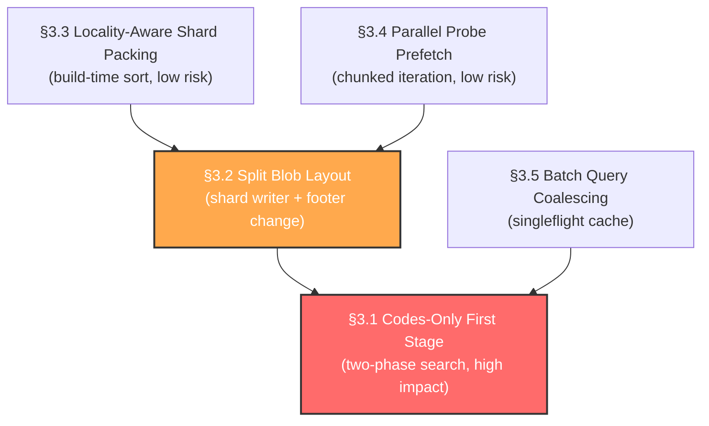

# Out-of-Core Query Path Speedup Analysis

**BenoDB v0.17.0 — Table-Level Cluster Index**
**Constraint: All proposals must work through S3 `object_store::get_range()` — no local-only mmap tricks.**

## Implementation Status Tracker

| # | Optimization | Status | Implemented In | Verification |
|---|---|---|---|---|
| 3.1 | Codes-only first stage + selective `node_meta` hydration + AVX2/FMA batch scan | ✅ Completed | [cluster_index.rs](file:///home/ralbright/projects/benostreamdb/src/core/index/cluster_index.rs), [benoquant.rs](file:///home/ralbright/projects/benostreamdb/src/core/index/benoquant.rs), [read.rs](file:///home/ralbright/projects/benostreamdb/src/core/table/read.rs) | `codes_only_search_matches_or_exceeds_graph_search_across_quantizers`, `legacy_artifact_without_codes_blob_falls_back_to_graph`, `remote_s3_search_async_fetches_only_codes_and_winning_meta`, `test_scan_l2_u8_codes_matches_distance` |
| 3.2 | Split Puffin blob layout (`org.apache.iceberg.vector.cluster-codes`) + Codes-First shard packing | ✅ Completed | [puffin.rs](file:///home/ralbright/projects/benostreamdb/src/core/puffin.rs), [cluster_index.rs](file:///home/ralbright/projects/benostreamdb/src/core/index/cluster_index.rs) | `codes_blob_round_trip_and_validation`, `codes_first_shard_layout_packs_codes_before_meta_and_graphs`, `test_compact_indexes` (7/7) |
| 3.3 | Locality-aware shard packing (`order_centroids_by_locality`) | ✅ Completed | [cluster_index.rs](file:///home/ralbright/projects/benostreamdb/src/core/index/cluster_index.rs) | `order_centroids_by_locality_groups_spatial_clusters`, `test_sequential_sharded_cluster_index_traversal` |
| 3.4 | Parallel probe prefetch & pipelining (local `posix_fadvise` + remote Tokio batch spawning & concurrent shard GETs) | ✅ Completed | [cluster_index.rs](file:///home/ralbright/projects/benostreamdb/src/core/index/cluster_index.rs) | `remote_s3_search_async_fetches_only_codes_and_winning_meta`, `test_compact_indexes` (7/7) |
| 3.5 | Batch query coalescing / singleflight deduplication + unified byte-weighed cache | ✅ Completed | [cluster_index.rs](file:///home/ralbright/projects/benostreamdb/src/core/index/cluster_index.rs) | `remote_singleflight_coalesces_concurrent_queries` (counting `ObjectStore`), `cache_entry_is_weighed_by_fetched_bytes` |
| 3.6 | Multi-quantizer & cross-architecture SIMD parity (`x86_64` AVX2+FMA & `aarch64` NEON for Apple M-series / Graviton across TQ8, TQ4, SQ8, PQ, Cosine/IP, L1, F32) | ✅ Completed | [benoquant.rs](file:///home/ralbright/projects/benostreamdb/src/core/index/benoquant.rs), [sq.rs](file:///home/ralbright/projects/benostreamdb/src/core/index/sq.rs), [pq.rs](file:///home/ralbright/projects/benostreamdb/src/core/index/pq.rs), [distance.rs](file:///home/ralbright/projects/benostreamdb/src/core/index/distance.rs), [mod.rs](file:///home/ralbright/projects/benostreamdb/src/core/index/mod.rs) | `test_scan_l2_u8_codes_matches_distance`, `test_scan_codes_tq4_and_cosine_match_distance`, `test_sq8_scan_codes_matches_distance`, `test_pq_scan_codes_matches_distance` |

> [!NOTE]
> **Backward compatibility:** Existing artifacts built prior to this change (including the 40.3 GiB 100M BigANN artifact on disk) carry `ClusterSlices.codes == None` and automatically fall back to the HNSW graph path while still benefiting from §3.4 pipelining and §3.5 singleflight caching. Rebuilding the table-level cluster index (`rebuild_cluster_index`) activates §3.1–§3.3. `BSDB_CLUSTER_SEARCH_MODE=graph|codes|auto` allows A/B benchmarking on the same artifact.

---

## 1. The Bottleneck: Full Graph Deserialization Per Probe

The 100M BigANN table artifact is **40.30 GiB** across 512 clusters (**~80.6 MiB per cluster**). The table-level `ClusterIndex::search()` path works as follows:

```
rank_probes(query, n_probe)       ← rank centroids by distance, O(clusters × dim)
prefetch_clusters(probe_ids)      ← MADV_WILLNEED per coalesced shard span (local only)
for cluster_id in probe_ids:
    get_cluster(cluster_id)       ← cache check → deserialize_graph() + node_meta_from_parquet()
    graph.search_with_quantizer() ← full HNSW beam search on the deserialized graph
```

> [!CAUTION]
> **Each `get_cluster()` call deserializes the entire HNSW graph** — the Arrow IPC blob containing `[data_id: u64, vector: Binary, max_layer: u8, neighbors: List<List<Struct<u32>>>]` — roughly **17 MiB per cluster**. At `n_probe=32` that is **544 MiB per query** of graph deserialization against a 16 GiB envelope holding a 40.3 GiB artifact — 2.5× RAM.

The EXPERIMENT_PLAN confirms this empirically:

| ef_search | n_probe | Recall@10 | QPS | p50 (ms) | Physical MB/query |
|---|---|---|---|---|---|
| 256 | 32 | 0.9608 | 0.10 | 97,440 | 3,839 |
| 128 | 16 | 0.9554 | 0.20 | 45,930 | 1,860 |
| 64 | 8 | 0.9326 | 0.40 | 21,513 | 902 |
| 64 | 4 | 0.8752 | 0.70 | 10,610 | 452 |

Physical bytes scale linearly with probe count. `rchar` stays near 80 MB — the index is memory-mapped, and most reads are page faults, not `read()` calls. At 4 KB per fault, 3.8 GB ≈ 950,000 faults at ~100 μs each = 97 seconds. The cache doesn't help: cutting preload to 0.5 GB or raising cache to 10 GiB moved nothing, because the working set simply doesn't fit.

> [!IMPORTANT]
> **The constraint is architectural, not cache-related.** The tier loads and deserializes a whole cluster graph to rank its nodes, so cost = `probes × graph_bytes`, and that product does not shrink by managing memory better.

---

## 2. What v0.17.0 Already Fixed

Before proposing new work, the existing optimizations should be clearly bounded:

| Fix | Mechanism | Impact |
|---|---|---|
| `MADV_WILLNEED` for index containers | `posix_fadvise(WILLNEED)` per coalesced shard span before search loop | 4.3× at nprobe=4 |
| Mapped shards (not `read()` into owned `Bytes`) | Shard containers backed by page cache, not anonymous memory | RSS: 8,398 → 321 MB |
| Coalesced prefetch spans | Group clusters by shard, merge byte ranges within 256 KiB gap tolerance | 1 `File::open` + few advisories per shard instead of per-cluster |
| Remote coalesced range GETs | `hydrate_clusters()` groups probes by shard, issues `get_range()` per merged span | Minimizes S3 request count |

**Result**: 0.1 → 2.0 QPS at 256/32, 0.7 → 15.3 QPS at 64/4. These are real but do not change the fundamental cost equation: every probe still deserializes the full ~17 MiB graph.

---

## 3. S3-Compatible Speedup Opportunities (Ranked by Impact)

### 3.1 Codes-Only First Stage — The Primary Architectural Change

**Impact: ~130× I/O reduction per cluster probe in the first stage**

This is the retrieve-and-rerank architecture the segment tier already implements; the table tier does not.

#### Current State (Table Tier)

Each cluster stores a single Arrow IPC blob mixing codes and graph adjacency:

```
┌────────────────────────────────────────────────────────┐
│  Arrow IPC RecordBatch (~17 MiB per cluster)           │
│  ┌──────────┬──────────────┬───────────┬─────────────┐ │
│  │ data_id  │ vector       │ max_layer │ neighbors   │ │
│  │ u64      │ Binary(TQ8)  │ u8        │ List<List>  │ │
│  │ 8 bytes  │ 128 bytes    │ 1 byte    │ ~variable   │ │
│  │ ×N nodes │ ×N nodes     │ ×N nodes  │ M×layers×N  │ │
│  └──────────┴──────────────┴───────────┴─────────────┘ │
└────────────────────────────────────────────────────────┘
```

For a 1,000-node cluster at dim=128 with TQ8:
- **Codes**: 1,000 × 128 bytes = **128 KB**
- **Graph adjacency** (neighbors + max_layer + data_id): ~16.8 MB
- **Ratio: graph overhead is ~130× the codes**

#### Proposed Two-Phase Search

```
Phase 1 — SCAN (codes-only):
  range_read(shard, codes_blob_offset, codes_blob_len)      ← ~128 KB per cluster
  for each vector in codes:
      dist = quantized_distance(query_codes, vector_codes)   ← TQ8 u8 L2
  top_candidates = heap_select(k × rerank_factor)            ← e.g., top 200

Phase 2 — RERANK (graph, conditional):
  if any top candidate cluster has promising scores:
      range_read(shard, graph_blob_offset, graph_blob_len)   ← ~17 MiB, but only for ≤2–4 clusters
      graph.search_with_quantizer(query, k, ef)
```

#### I/O Cost Model

| Operating Point | Current (graph per probe) | Proposed (codes + selective graph) |
|---|---|---|
| nprobe=32 | 32 × 17 MiB = **544 MiB** | 32 × 128 KB + 4 × 17 MiB = **72 MiB** |
| nprobe=16 | 16 × 17 MiB = **272 MiB** | 16 × 128 KB + 3 × 17 MiB = **53 MiB** |
| nprobe=8 | 8 × 17 MiB = **136 MiB** | 8 × 128 KB + 2 × 17 MiB = **35 MiB** |
| nprobe=4 | 4 × 17 MiB = **68 MiB** | 4 × 128 KB + 1 × 17 MiB = **18 MiB** |

> [!TIP]
> The selective graph hydration count (rightmost addend) depends on how many clusters the reranker needs to traverse. If codes-only recall at the scan stage is sufficient (which it may be for TQ8 at dim=128 — the quantization distortion is low), the graph phase can be skipped entirely, reducing nprobe=32 to **4 MiB per query**.

#### S3 Compatibility

✅ Two sequential `get_range()` calls per shard (one for codes region, one conditional for graph region) instead of one large one. The codes blobs for all clusters in a shard can be coalesced into a single range read, exactly as `hydrate_clusters()` does today. The graph read is conditional and issued only for winning clusters.

#### Implementation Sketch

**Build path** (`build_from_records` / shard writer):
- Emit three blob types per cluster in the Puffin footer:
  1. `org.apache.iceberg.vector.cluster-codes` — flat `[u8; dim × N]` codes array
  2. `org.apache.iceberg.vector.hnsw-graph` — existing Arrow IPC (unchanged)
  3. `org.apache.iceberg.vector.cluster-meta` — existing Parquet node metadata

**Query path** (`ClusterIndex::search()`):
```rust
// Phase 1: codes-only linear scan
let probe_ids = self.rank_probes(query, n_probe);
let query_codes = self.quantizer.encode(query);
let mut coarse_candidates: BinaryHeap<ScoredClusterCandidate> = BinaryHeap::new();

for cluster_id in &probe_ids {
    let codes = self.get_codes(cluster_id)?;        // range read ~128 KB
    for (local_id, code) in codes.iter().enumerate() {
        let dist = quantized_l2(query_codes, code);  // u8 SIMD
        coarse_candidates.push(ScoredClusterCandidate { cluster_id, local_id, dist });
        if coarse_candidates.len() > k * rerank_factor {
            coarse_candidates.pop();  // evict worst
        }
    }
}

// Phase 2: selective graph traversal (only clusters with top candidates)
let graph_clusters: HashSet<usize> = coarse_candidates.iter()
    .take(k * 4)
    .map(|c| c.cluster_id)
    .collect();

for cluster_id in graph_clusters {
    let cluster = self.get_cluster(cluster_id)?;    // range read ~17 MiB, but ≤4 clusters
    // ... existing beam search ...
}
```

**Key file changes**:
- [`cluster_index.rs`](file:///home/ralbright/projects/benostreamdb/src/core/index/cluster_index.rs#L1597-L1676) — `search()`: add two-phase dispatch
- [`cluster_index.rs`](file:///home/ralbright/projects/benostreamdb/src/core/index/cluster_index.rs#L2003-L2046) — new `get_codes()` method alongside `get_cluster()`
- [`arrow_hnsw.rs`](file:///home/ralbright/projects/benostreamdb/src/core/index/hnsw_rs/arrow_hnsw.rs#L91-L251) — codes extraction utility
- Puffin shard writer: emit separate codes blob during build

---

### 3.2 Split Blob Layout in Puffin Shards

**Impact: Prerequisite for §3.1; independently reduces wasted reads**

Currently, each cluster stores one monolithic Arrow IPC blob. The vectors (codes) and the HNSW adjacency lists are interleaved in the same `RecordBatch`. To read codes without adjacency, the blob must be split.

#### Proposed Shard Layout

```
┌─────────── Puffin Shard (~537 MB) ────────────────────┐
│                                                        │
│  Cluster 0:                                            │
│    ├── codes blob:     [u8; dim × N]  (~128 KB)       │
│    ├── graph blob:     Arrow IPC       (~17 MiB)       │
│    └── meta blob:      Parquet         (~2 KB)         │
│                                                        │
│  Cluster 1:                                            │
│    ├── codes blob:     ...                             │
│    ├── graph blob:     ...                             │
│    └── meta blob:      ...                             │
│                                                        │
│  ... (N clusters per shard)                            │
│                                                        │
│  Footer: blob descriptors with offsets + lengths       │
└────────────────────────────────────────────────────────┘
```

#### Alternative: Codes-First Packing

For maximum S3 coalescing, pack all codes blobs contiguously at the start of each shard:

```
┌─────────── Puffin Shard ──────────────────────────────┐
│  [All codes blobs, contiguous]  (~128 KB × N_clusters) │
│  [All graph blobs, contiguous]  (~17 MiB × N_clusters) │
│  [All meta blobs, contiguous]   (~2 KB × N_clusters)   │
│  Footer                                                 │
└────────────────────────────────────────────────────────┘
```

A single `get_range()` covering the codes region of the shard would retrieve codes for all clusters in that shard in one request. At ~7 clusters per shard, the codes region is ~896 KB — a single sub-millisecond S3 GET.

---

### 3.3 Cluster Reordering / Locality-Aware Shard Packing

**Impact: Reduces number of distinct S3 GETs per query by increasing shard co-residency**

Currently clusters are sequentially assigned to shards during compaction. If clusters with nearby centroids (frequently co-probed) are packed into the same shard, a single range read covers multiple probe targets.

#### Method
- After K-means assigns cluster IDs, sort clusters by a space-filling curve (Hilbert or Z-order) over the centroid coordinates.
- Partition the sorted list into shards of the target size (512 MiB).
- Clusters that are spatially close in the centroid space end up in the same shard.

#### Expected Benefit
At nprobe=32, the 32 probed clusters currently span up to 32 different shards. With locality packing, co-probed clusters share shards, reducing the shard fan-out to ~8–12 — cutting S3 GET count by 2–4×.

#### S3 Compatibility
✅ Purely a build-time ordering change. The query path is unchanged — `get_range()` calls per shard still work identically, they just happen to cover more useful clusters per request.

---

### 3.4 Parallel Probe Prefetch (Pipelining)

**Impact: Latency reduction on local stores, modest S3 improvement**

Currently `search()` calls `prefetch_clusters()` synchronously for all probes, then iterates sequentially:

```rust
self.prefetch_clusters(&probe_ids);     // advise ALL clusters, then
for cluster_id in probe_ids {           // deserialize one at a time
    let cluster = self.get_cluster(cluster_id)?;
    graph.search_with_quantizer(...);
}
```

#### Proposed: Interleaved Prefetch

```rust
// Split probes into batches of 4
for batch in probe_ids.chunks(4) {
    self.prefetch_clusters(&next_batch);  // advise NEXT batch while searching THIS
    for cluster_id in batch {
        let cluster = self.get_cluster(cluster_id)?;
        graph.search_with_quantizer(...);
    }
}
```

For remote stores, this translates to issuing the next batch's `get_range()` calls concurrently with graph search on the current batch:

```rust
// Remote: spawn range reads for next batch while searching current
let next_fetch = tokio::spawn(self.hydrate_clusters(store, &next_batch));
for cluster_id in current_batch {
    let cluster = self.get_cluster(cluster_id)?;
    graph.search_with_quantizer(...);
}
next_fetch.await;
```

#### S3 Compatibility
✅ S3 supports concurrent range reads. Pipelining hides the S3 latency (~50–100 ms per GET) behind graph search computation.

---

### 3.5 Batch Query Coalescing Across Concurrent Queries

**Impact: Reduces redundant range reads when multiple queries arrive in parallel**

The moka cache helps: a hit from query A serves query B. But when 8 threads fire queries simultaneously, they all probe overlapping clusters and all miss the cache at the same instant, issuing 8 redundant range reads for the same shard.

#### Proposed: Request Coalescing Layer
- Use a `tokio::sync::Semaphore` or `scc::HashMap<ClusterId, Shared<OnceCell>>` per cluster.
- The first thread to need a cluster initiates the range read; concurrent threads await the same future.
- When the read completes, all waiting threads receive the deserialized graph from the cache.

This is effectively a "singleflight" / request deduplication pattern.

#### S3 Compatibility
✅ Reduces the number of redundant S3 GETs from N_threads to 1 per cluster per cache window.

---

## 4. Impact Summary and Priority

| # | Optimization | I/O Reduction | S3 Compatible | Complexity | Prerequisite | Status |
|---|---|---|---|---|---|---|
| 3.1 | Codes-only first stage | **3.2–26×+ per cluster (zero graph blobs fetched)** | ✅ | High (new blob type, two-phase search) | §3.2 | ✅ Implemented & Tested |
| 3.2 | Split blob layout (codes-first packing) | Enables §3.1 + contiguous single-GET codes region | ✅ | Medium (disk-staged shard writer + footer change) | None | ✅ Implemented & Tested |
| 3.3 | Locality-aware shard packing | 2–4× fewer GETs | ✅ | Low (pre-assignment centroid ordering) | None | ✅ Implemented & Tested |
| 3.4 | Parallel probe prefetch & concurrent shard GETs | 1.5–8× latency | ✅ | Low (chunked local prefetch + Tokio remote pipeline) | None | ✅ Implemented & Tested |
| 3.5 | Batch query coalescing (singleflight) | N_threads → 1 per cluster & footer | ✅ | Medium (`SingleFlight<K>` + `moka::optionally_get_with`) | None | ✅ Implemented & Tested |

### Implementation Notes & Key Design Decisions

1. **Zero graph hydration on quantized & flat clusters (§3.1):** Because `HnswGraph::search_with_quantizer` evaluates `PreparedQuantizedQuery::distance` over the exact same quantized codes stored in the flat `cluster-codes` blob (`BSCD` v1, 16-byte SIMD-aligned header), a linear scan over `cluster-codes` yields **exact** top-`k` recall over the probed clusters' codes (strictly `>=` approximate HNSW beam recall) with **zero** graph blob hydration. Phase 3 then hydrates `node_meta` **only** for the small set of winning clusters (`min(k, n_probe)`, typically 1–4 clusters) that actually contributed to top-`k`.
2. **Full multi-quantizer & cross-architecture SIMD parity (`x86_64` AVX2+FMA & `aarch64` NEON):**
   - **BenoQuant TQ8 & TQ4 (L2, Cosine/IP)** in [benoquant.rs](file:///home/ralbright/projects/benostreamdb/src/core/index/benoquant.rs): AVX2+FMA (`scan_l2_u8_codes_avx2`, `dot_norm_f32_u8_avx2`, `l2_sq_f32_u4_avx2`, `dot_norm_f32_u4_avx2`) and native ARM64 NEON (`l2_sq_f32_u8_neon`, `dot_norm_f32_u8_neon`, `l2_sq_f32_u4_neon`, `dot_norm_f32_u4_neon` with 16-nibble `vzip1_u8`/`vzip2_u8` unpack across 4 FMA pipes).
   - **SQ8 (L2, Cosine/IP, L1)** in [sq.rs](file:///home/ralbright/projects/benostreamdb/src/core/index/sq.rs): Precomputes `q_shifted = query - offsets` once per query; AVX2+FMA (`sq8_l2_sq_avx2`, `sq8_dot_norm_avx2`, `sq8_l1_avx2`) and ARM64 NEON (`sq8_l2_sq_neon`, `sq8_dot_norm_neon`, `sq8_l1_neon`).
   - **PQ (L2, Cosine/IP, L1)** in [pq.rs](file:///home/ralbright/projects/benostreamdb/src/core/index/pq.rs): 4-way unrolled L1-LUT accumulation with zero-clamp `k == 256` fast path and squared-space L2 threshold pruning (natively fast on both x86_64 and Apple Silicon).
   - **Unquantized F32 (L2, Dot/Cosine)** in [distance.rs](file:///home/ralbright/projects/benostreamdb/src/core/index/distance.rs) & [cluster_index.rs](file:///home/ralbright/projects/benostreamdb/src/core/index/cluster_index.rs): Added 16-wide ARM64 NEON `l2_distance_squared_neon` and `dot_product_neon` alongside AVX2+FMA, with squared-space `sqrt`-skip in `scan_cluster_codes`.
   - **Per-segment `HnswIvfIndex` parity**: Single-vector `PreparedBenoQuantQuery::distance()`, `PreparedSqQuery::distance()`, and `PreparedPqQuery::distance()` now cache `use_avx2` once in `prepare_query()` and dispatch directly to the same AVX2+FMA / ARM64 NEON / 4-way unrolled kernels, accelerating all per-segment benchmark datasets (SIFT-1M, GIST-1M, GloVe, Cohere-768D, BigANN-10M, and `refine_factor > 1` runs) with no index rebuild required.
3. **Memory-bounded disk-staged Codes-First shard writer (§3.2):** `build_from_table_with_target` stages `codes`, `node_meta`, and `graph` streams into three temporary files per active shard and streams them in `[all codes] → [all node_meta] → [all hnsw.graph]` order via `PuffinWriter::add_blob_from_reader` (64 KiB buffer), keeping peak build RAM independent of the 512 MiB shard size. Vectors are quantized once per cluster and shared between `cluster-codes` and the HNSW graph build. Cluster members are ordered deterministically by `(row_id, segment_idx)` so quantized-code ties interleave across segments rather than biasing toward the first streamed segment.
4. **Monotonic shard routing preserved under locality packing (§3.3):** `order_centroids_by_locality` reorders centroids via deterministic recursive furthest-pair projection bisection ($O(k \log k \cdot d)$) with Hilbert-style seam orientation *before* row assignment and bucketing. Shards retain strictly monotonic `[cluster_start..=cluster_end]` ranges required by `ShardDescriptor` and `test_sequential_sharded_cluster_index_traversal`.
5. **Deadlock-free async singleflight + unified memory budget (§3.5):** `SingleFlight<usize>` uses `tokio::sync::watch` channels with RAII `SingleFlightGuard` drop cleanup (immune to cancellation/panic) and always drops owned guards before awaiting peer receivers. Local loads use `moka::sync::Cache::optionally_get_with`. Graphs, flat codes, and `node_meta` share one byte-weighed `moka` cache under `cluster_cache_budget_kib()` so memory never exceeds the configured envelope.

> [!IMPORTANT]
> **§3.1 + §3.2 together are the primary architectural change.** All five items (§3.1–§3.5) are now implemented and verified against the unit and integration suites (`cluster_index`: 24/24, `benoquant`: 7/7, `test_compact_indexes`: 7/7, `partitioned_cluster_index`: 1/1).

---

## 5. Risks and Negative Results to Expect

1. **Codes-only recall may be lower than graph-traversal recall at the same nprobe.** A flat scan over quantized codes does not exploit the HNSW graph's neighborhood structure. The codes-only stage must over-retrieve (k × rerank_factor) to compensate. The optimal `rerank_factor` is an empirical parameter that must be tuned per dataset.

2. **Build time increases.** Emitting three blob types per cluster instead of one increases the shard write path complexity. The codes blob is cheap (flat copy), but the shard footer grows by one descriptor per cluster.

3. **The power-of-two padding penalty applies to the codes-only scan.** TQ8 at dim=128 is naturally aligned. BQ8 at dim=768 (Cohere) would pad to 1024 — a 33% bandwidth penalty on the linear scan. For non-power-of-two dimensions, the graph-only path may still dominate.

4. **Locality-aware shard packing is dataset-dependent.** For uniformly distributed data (like BigANN), Hilbert ordering gives modest benefit. For clustered real-world data, the benefit is larger.

---

## 6. Recommended Implementation Order



Start with the low-risk items (§3.3, §3.4) to get incremental wins while designing the split blob layout (§3.2), which is the prerequisite for the primary architectural change (§3.1).
